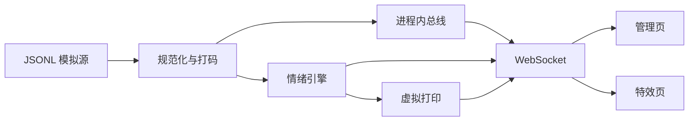

# 直播互动演示（P1）

本地可跑的直播互动特效 + 虚拟打印演示。事件来自 JSONL 回放和剧本，不连接任何直播平台，也不驱动真实打印机。

P1 做到这些事：

- 模拟源按 1x / 5x / 20x 回放，可循环，可在运行中改速度。
- 三个剧本：小礼物连击、大礼物榜一、弹幕刷屏，外加一份综合回放。
- 规范化：去重、连击合并、同文弹幕 **200ms** 聚合、用户标识哈希和昵称打码。
- 进程内总线把 `event` / `emotion` / `fx_cue` / `print_job` / `print_progress` 推到管理页和特效页。
- 断线后按序号补发最近 **30 秒** 的消息。
- 最小情绪引擎：上升、保持、指数衰减，高优先级压低低优先级。弹幕只做氛围。
- 虚拟打印进度条，在 25/50/75/90/100 推动情绪。
- 管理页可改映射 YAML 并热加载。非法 YAML 会被拒绝，进程继续跑旧配置。
- `live.collection_enabled` 默认 `false`。打开时写审计日志。官方适配器是禁用桩。

不做的事：官方采集、绕过登录或风控、OBS/Three/Pixi 正式演出、照片转 3D、长时间浸泡测试。

## 目录

```
.
├── README.md
├── pyproject.toml
├── package.json                 # npm workspaces：apps/admin、apps/overlay
├── config/
│   ├── default.yaml             # 服务、回放、情绪、打印、30 秒缓冲
│   ├── mappings.yaml            # L0–L4 档位
│   ├── compliance.yaml
│   └── secrets.yaml.example
├── data/samples/                # 综合回放 + 三个剧本
├── src/                         # FastAPI 管线
├── apps/admin/                  # 中文控制台
├── apps/overlay/                # 最小特效页（不是 Three/Pixi）
├── tests/
└── scripts/start.sh、start.bat
```

`price` 是本地档位分，不是平台礼物标价，也不是官方礼物 ID。样本里的 `gift_id` 都是 `local_*` 占位。

昵称只保留第一个字符，其余变成 `*`。用户 ID 用盐做 SHA-256。`raw_ref` 只留在服务端，不会进 WebSocket、HTTP 或 SQLite。

## 安装

需要 Python 3.11+。要构建页面再装 Node.js 18+。

```bash
python3 -m venv .venv
source .venv/bin/activate          # Windows: .venv\Scripts\activate
python -m pip install -e ".[dev]"
npm install
npm run build
```

可选：把 `config/secrets.yaml.example` 复制为 `config/secrets.yaml` 并改掉 `pii_salt`。不复制时使用合规配置里的演示盐，也可以用环境变量 `LIVE_SHOW_SALT`。

## 启动

POSIX（macOS / Linux）：

```bash
bash scripts/start.sh
```

Windows：

```bat
scripts\start.bat
```

脚本会创建虚拟环境、安装依赖、在有 npm 时构建页面，然后监听 `127.0.0.1:8787`（见 `config/default.yaml`）。

开发时也可以只起 API，页面用 Vite：

```bash
python -m src.main
npm run dev:admin      # http://127.0.0.1:5173/admin/
npm run dev:overlay    # http://127.0.0.1:5174/overlay/
```

## 打开页面

API 起来并且 `npm run build` 之后：

- 管理控制台：<http://127.0.0.1:8787/admin/>
- 特效预览：<http://127.0.0.1:8787/overlay/>
- 说明页：<http://127.0.0.1:8787/>
- OpenAPI：<http://127.0.0.1:8787/docs>

管理页可以：

- 开始 / 停止综合回放，切换 1x、5x、20x 和循环。
- 点三个剧本，或「突发 200 条/秒」。
- 暂停 / 继续事件列表。暂停只停界面，后台继续收，继续后把积压补上。
- 点 L0–L4，更新情绪并发送 `fx_cue`。
- 编辑映射 YAML，保存后热加载。写错会看到错误，旧表继续生效。
- 创建一条虚拟打印任务，看进度走到完成。
- 打开「真实采集」。这只会写 `data/audit/audit.jsonl`，官方适配器不会连接任何平台。

特效页会跟着情绪变色，飘过弹幕，并显示虚拟打印进度。

## 剧本

| 名称 | 文件 | 在管理页上的按钮 |
| --- | --- | --- |
| 综合回放 | `data/samples/replay.jsonl` | 开始回放 |
| 小礼物连击 | `data/samples/scene_small_gift_combo.jsonl` | 小礼物连击 |
| 大礼物榜一 | `data/samples/scene_big_gift_rank1.jsonl` | 大礼物榜一 |
| 弹幕刷屏 | `data/samples/scene_danmaku_flood.jsonl` | 弹幕刷屏 |

也可以直接调 API：

```bash
curl -X POST http://127.0.0.1:8787/api/scenes/start \
  -H 'Content-Type: application/json' \
  -d '{"name":"big_gift_rank1","speed":5}'
```

场景名只有 `small_gift_combo`、`big_gift_rank1`、`danmaku_flood`。

同文弹幕按**实际到达时间**聚合，窗口固定 200ms。把回放打到 20x 时，文件里的间隔会被压短，原本分开的同文可能合成一条。要用文件里的原始间隔看聚合，用 1x。

## 测试

```bash
python -m pytest -q
```

覆盖：去重、连击合并、200ms 聚合（并确认 1.5 秒不会被当成 2 秒窗口）、打码、情绪曲线和压低、弹幕不抢主秀、打印里程碑、30 秒缓冲、非法 YAML、采集审计、200 条峰值零丢弃、三个剧本、L0–L4 和虚拟打印、WebSocket 补发。

P2 另有：重连退避不超过 5 秒、按 `event_id` 的去重窗口、队列满时丢最旧并告警、真实源二次确认与审计、加密原文删除，以及 1000 条/秒模拟压测。

```bash
python scripts/load_test.py
python -m pytest -q tests/test_load.py
```

压测数字见 [docs/p2-load-test.md](docs/p2-load-test.md)。官方接入只核对公开资料，见 [docs/douyin-official-ingest-checklist.md](docs/douyin-official-ingest-checklist.md)。

## 配置

`config/default.yaml` 里和演示直接相关的键：

- `live.collection_enabled`：默认 `false`。
- `live.real_source`：默认 `false`。环境变量 `REAL_SOURCE` 不设置也是关闭；设成 `false` / `0` 时，确认接口也会拒绝打开。改配置文件本身不会把真实源打开，管理页或 `POST /api/compliance/real-source` 必须带二次确认。
- `adapters.sim_replay`：样本目录和 1/5/20 速度。`adapters.official.enabled` 必须是 `false`，热加载也不允许改成开启。`contract` 和 `credential_env` 只是占位。
- `adapters.governance`：心跳、退避上限 5 秒、`event_id` 去重窗口、队列容量。队列满时丢掉最旧的一条并记 `backpressure` 告警，好让新的观众事件还能进来。
- `normalize.danmaku_aggregate_window_ms`：必须是 `200`。
- `emotion.rise_ms`：150–300。`decay_half_life_s`：4–8。`max_on_screen` 和 `ducking` 控制同时在场的情绪。
- `print_show.default_duration_sec`：默认 45 秒。进度点固定 25/50/75/90/100。
- `bus.reconnect_buffer_sec`：必须是 30。

映射在 `config/mappings.yaml`：

| 档 | 触发 | 情绪 | 打印 |
| --- | --- | --- | --- |
| L0 | 点赞、进场 | 氛围 | 无 |
| L1 | 弹幕、评论 | 氛围，不抢主秀 | 无 |
| L2 | 关注、档位分 ≤ 9 的礼物 | 喜悦 | 无 |
| L3 | 档位分 10–99 | 热场 | 卡通 |
| L4 | 档位分 ≥ 100；`highlight: rank1` 用榜一特效名 | 震撼 | 全息 |

改映射可以在管理页保存，也可以直接改文件。进程大约每 0.4 秒看一次文件。解析失败时保留上一份，并记在 `GET /api/health` 的 `config_error`。

SQLite 在 `data/live_show.db`，存打码后的事件、虚拟打印任务和审计索引。若另外保存原文，只存 HMAC-SHA256 计数器模式加密后的密文。`DELETE /api/raw-payloads` 或管理页「删除加密原文」会清掉这些密文。WebSocket 仍然不传 `raw_ref` 和原始身份。

## 合规

官方适配器在 `src/adapters/official.py`。`start()` 固定返回未启动，文件里没有平台地址，也没有登录、签名、Cookie 或反爬代码。

打开采集有两个入口，都会在从关到开时写审计：

- `POST /api/compliance/collection`，正文 `{"enabled": true}`。
- 把 `config/default.yaml` 的 `collection_enabled` 改成 `true`（启动时已经是 `true` 也会记一条）。

审计文件：`data/audit/audit.jsonl`。

真实源是另一道开关。管理页勾选「真实源」后还会再弹一次确认；接口要 `{"enabled": true, "confirm": true}` 才会写 `real_source_enabled` 审计。确认之后可以 `POST /api/adapters/official/start` 做健康检查，返回降级且 `events_pushed` 为 0。模拟源 `mock` 不依赖这道开关。没有实现非官方采集。

## WebSocket

地址：`ws://127.0.0.1:8787/ws`

消息形如 `{ "v": 1, "kind": "...", "seq": 12, "ts": 0, "data": {} }`。

`kind` 为 `event`、`emotion`、`fx_cue`、`print_job`、`print_progress` 的消息进入 30 秒缓冲。`hello`、`buffer_gap`、`replay_done` 是连接级控制消息，不进缓冲。

重连时带上最后看到的序号：`/ws?since_seq=120`。服务端补发 `seq` 更大且还在 30 秒内的消息，然后发 `replay_done`。如果请求的序号已经早于缓冲区，会先收到 `buffer_gap`。省略 `since_seq` 或传负数表示只听新消息。

## 延迟怎么量

两条时间：

1. **管线入队**：`ingest` 入口到信封 `put_nowait` 进每个 WebSocket 队列。包含规范化和 SQLite 写入，不含浏览器网络栈。`GET /api/metrics` 的 `latency_ms.p50` / `p99` 就是这个数。
2. **本机端到端**：测试里起一个 localhost 进程，`POST /api/events/simulate` 之后从 `/ws` 读到对应 `event_id`。包含这次 HTTP 往返。

自动化门禁是这两条的 p99 都要小于 100ms，见 `tests/test_api_acceptance.py::test_event_to_ws_latency_under_100ms`。

本次在当前环境、30 条本机点赞上测到：

| 口径 | p50 | p99 |
| --- | --- | --- |
| 管线入队 | 2.27 ms | 3.59 ms |
| HTTP 注入到 WS 读回 | 16.22 ms | 20.59 ms |

丢弃数为 0。换机器数字会浮动，以测试是否仍低于 100ms 为准。

200 条/秒由 `POST /api/replay/burst`（`count=200`，`window_sec=1`）注入互不合并的模拟点赞。`tests/test_api_acceptance.py::test_burst_endpoint_two_hundred_in_one_second` 断言收到 200、发布 200、丢弃 0。另有一个无间隔的 200 并发注入测试，同样要求零丢弃。

## 验收清单

- [x] 端到端演示不连接真实平台。官方适配器是禁用桩，默认采集关闭。
- [x] 本机事件到 WS 的 p99 低于 100ms。上面的表是本次测量；测试会再卡一次。
- [x] 峰值 200 条/秒零丢弃。`test_burst_endpoint_two_hundred_in_one_second` 与 `test_two_hundred_concurrent_events_are_not_dropped`。
- [x] 30 秒重连缓冲有效。`test_buffer_keeps_30s_and_replays_cursor` 用假时钟推进到 31 秒；`test_ws_replays_missed_events_and_strips_pii` 在断开期间触发 L4，重连后能补到 `fx_cue`。
- [x] YAML 热加载。合法修改立刻改变 L0 情绪；非法 YAML 返回 400，进程和旧映射都还在。`test_api_rejects_bad_yaml_and_keeps_serving`。
- [x] 管理页能触发 L0–L4，也能创建虚拟打印并跑到 `done`。对应 API 测试：`test_manual_levels_and_print_job`。页面按钮走同一组接口。
- [x] 三个剧本可从 API 启动。小礼物合并成一条 `combo_count=10` 的喜悦事件且不打印；榜一礼物开出全息任务且情绪保持震撼。`test_scripted_scenes`。
- [x] `REAL_SOURCE` 关闭时，回放、模拟源和演示管道仍可用。没有二次确认就不会写 `real_source_enabled`。`test_real_source_off_keeps_demo_and_blocks_silent_enable`。
- [x] 二次确认后可以健康检查官方桩，状态是降级，推送条数为 0，并写审计。`test_confirmed_real_source_audits_and_degrades`。
- [x] 重连退避不超过 5 秒，`event_id` 去重窗口，队列满时丢最旧并告警。`tests/test_governance.py`。
- [x] 原文加密保存，列表接口不回明文，`DELETE /api/raw-payloads` 能删光。`test_encrypted_raw_roundtrip_and_delete`。
- [x] 模拟源 1000 条/秒。见 [docs/p2-load-test.md](docs/p2-load-test.md)。入队到总线 p99 约 1.24 ms，峰值内存约 1.5 MB，按策略没有丢弃。

本次 `python -m pytest -q`：**44 passed**。

没有实现非官方采集，也没有平台请求格式或签名算法。官方接入核对清单在 [docs/douyin-official-ingest-checklist.md](docs/douyin-official-ingest-checklist.md)。

## 数据流


